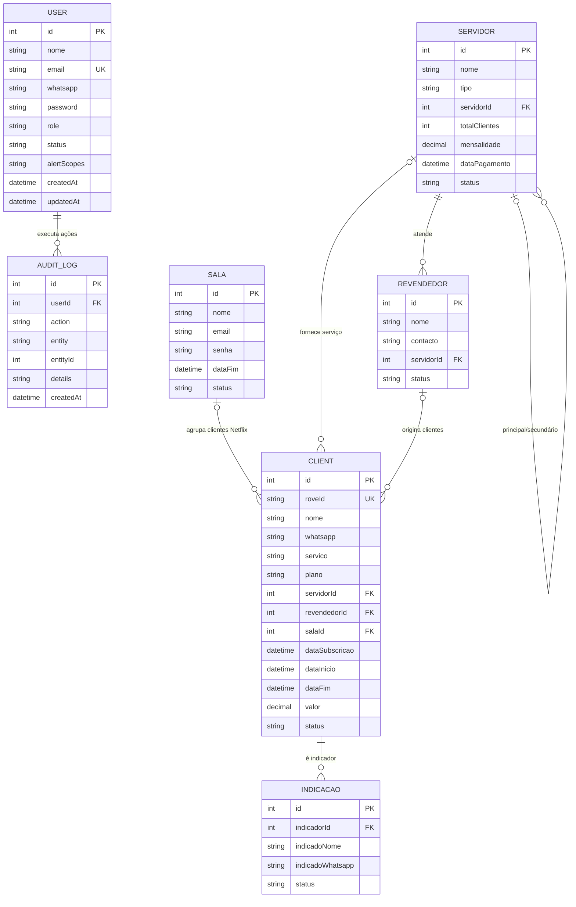

# Modelagem de Dados - Rove+ Painel

## Escopo e fonte da modelagem

Este documento descreve a estrutura observada no Prisma e o comportamento de persistência usado pela API. A fonte principal é `prisma/schema.prisma`; as rotas e helpers em `server/` complementam o schema com regras de negócio e colunas de compatibilidade criadas em runtime.

**O painel gere apenas o serviço Netflix.** A funcionalidade IPTV (servidores, revendedores, credenciais IPTV, perfil de operador `iptv`) foi removida do código. As tabelas `servidores` e `revendedores` e as colunas IPTV de `clients` continuam no schema e na base apenas para não perder dados históricos; a API filtra sempre `servico = 'netflix'`.

O banco é PostgreSQL. O Prisma gera chaves inteiras autoincrementais, utiliza `createdAt`/`updatedAt` nos registos operacionais e mapeia alguns nomes do domínio para nomes SQL legados.

## Diagrama entidade-relacionamento

`o|` representa uma associação opcional do lado que contém a chave estrangeira; `||--o{` representa um registo pai associado a zero ou muitos registos filhos.

## Entidades

### User - utilizadores do painel

Tabela física `"User"`.

- Identificação e contacto: `id`, `nome`, `email` (único), `whatsapp` opcional.
- Acesso: `password` contém hash bcrypt; `role` guarda o perfil; `status` controla acesso ativo/suspenso.
- Preferências: `alertScopes` guarda como texto JSON categorias de alertas; nulo significa usar os padrões do perfil.
- Auditoria: um utilizador pode ter vários `AuditLog`.
- Perfis encontrados no código: `admin`, `geral`, `netflix`, `iptv` e `financeiro`; `suporte` é tratado como compatibilidade em alguns pontos.

### Client - cliente e subscrição

Tabela física `clients`. É a entidade central e combina dados de identidade, serviço e subscrição.

- Identificação: `id`, `roveId` opcional e único, `nome`, `whatsapp`, `localizacao` opcional.
- Produto: `servico` (normalmente `netflix` ou `iptv`), `plano`, `perfil` e `pin` opcionais.
- Credenciais IPTV opcionais: `iptvUser`, `iptvPass`, `iptvMac`, `iptvM3u`.
- Ligações opcionais: `servidorId`, `revendedorId` e `salaId`.
- Ciclo da subscrição: `dataSubscricao`, `dataInicio`, `dataFim`, `valor` (decimal 10,2), `status` (`ativo`, `vencido`, `cancelado`) e `inscricaoPaga` opcional, usada sobretudo para Netflix.
- Área do cliente: `portalPinHash`, `portalFirstLogin` e os campos de PIN adicionais descritos em “Colunas de compatibilidade”.
- Operação: `whatsappNotificadoVencimentoAt`, contador `indicacoes`, `createdAt` e `updatedAt`.
- Um cliente pode ser indicador de várias indicações. A aplicação tenta manter `indicacoes` como contador dessas indicações.

### Sala - conta Netflix partilhada

Tabela física `salas`.

- Guarda nome, email/senha da conta, observações, `dataFim` partilhada e estado (`ativo`/`suspenso`).
- Uma sala tem zero ou muitos clientes; cada cliente tem no máximo uma sala (`Client.salaId` opcional).
- A rota de criação de cliente pode alinhar a data final do cliente com a data final da sala. A rota de renovação da sala também gere a data partilhada.

### Servidor - infraestrutura IPTV

Tabela física `servidores`.

- Guarda nome, tipo (`principal`/`secundario`), estado (`online`/`instável`/`offline`), total de clientes e custo mensal opcional.
- `servidorId` é uma autorrelação opcional: um servidor secundário pode apontar para o servidor principal; um principal pode ter vários secundários.
- Um servidor pode estar associado a vários clientes e revendedores. As rotas exigem que o servidor associado a um revendedor seja principal.
- `dataPagamento` guarda a próxima data de pagamento do servidor.
- O total exibido de clientes é calculado pela relação no Prisma, embora exista também o campo persistido `totalClientes`.

### Revendedor - canal de venda IPTV

Tabela física `revendedores`.

- Guarda nome, contacto, observações e estado (`ativo`/`suspenso`).
- Cada revendedor deve estar associado a um servidor principal (`servidorId`); pode ter vários clientes.
- A associação do cliente a um revendedor é opcional.

### Indicacao - referência de potencial cliente

Tabela física `indicacoes`.

- `indicadorId` é obrigatório e referencia o cliente que indicou.
- O nome e WhatsApp do indicado são armazenados diretamente na indicação. Não existe ainda FK para um cliente indicado nem conversão automática para `Client`.
- Estado de negócio usado: `pendente` ou `confirmada`.
- Ao criar/apagar uma indicação, a API incrementa/decrementa `Client.indicacoes`. Ao apagar o cliente indicador, a FK está configurada para apagar as indicações dependentes (`onDelete: Cascade`).

### AuditLog - trilho de auditoria

Tabela física `audit_logs`.

- Cada registo tem utilizador obrigatório, ação, entidade, ID da entidade opcional, detalhes e data.
- `entity` e `entityId` são uma referência polimórfica lógica, não uma FK para cada tabela de negócio. Por isso, o banco não garante que o alvo exista.
- A relação com utilizador tem `onDelete: Cascade`; a rota de remoção de utilizador também apaga explicitamente os seus logs.
- As ações incluem criação, alteração, renovação, pagamento, suspensão e remoção de entidades.

## Relações e cardinalidades

| Relação | Cardinalidade | Chave e observação |
|---|---|---|
| Sala - Client | 1 para 0..N | `clients.sala_id`; nula quando o cliente não está numa sala |
| Servidor - Client | 1 para 0..N | `Client.servidorId`; opcional |
| Revendedor - Client | 1 para 0..N | `clients.revendedor_id`; opcional |
| Servidor principal - Servidor secundário | 1 para 0..N | `servidores.servidor_id`; autorrelação opcional |
| Servidor - Revendedor | 1 para 0..N | `Revendedor.servidorId`; a API valida tipo principal |
| Client indicador - Indicacao | 1 para 0..N | `indicacoes.indicador_id`; apagar indicador apaga indicações |
| User - AuditLog | 1 para 0..N | `audit_logs.user_id`; apagar utilizador apaga logs associados |

## Regras derivadas e limites funcionais

- O estado `vencido` é atualizado pela API com base em `dataFim`; não é uma coluna calculada nem uma rotina do banco.
- As métricas financeiras do dashboard são estimativas calculadas a partir de `Client.valor`, datas/status e custos de `Servidor.mensalidade`. O custo Netflix vem da configuração `SALA_NETFLIX_CUSTO_MENSAL`.
- Pagamentos de clientes ficam em `pagamentos` (1 linha por pagamento: dia, nº de meses, valor, método) e `periodos_pagos` (1 linha por mês coberto, com `inicio`, `fim` e `notificado_at`). `Client.dataFim` é um atalho igual ao `fim` do último período pago. Pagamentos de salas ficam em `pagamentos_sala`.
- Atraso de um pagamento: automático se a data em que pagou passa o limite de renovação do pagamento anterior (dia 10 do mês a seguir ao último mês que ele cobriu; o primeiro pagamento nunca é atrasado). `pagamentos.atraso_manual` (null = automático) guarda a marcação do gestor. Um mês só pode estar coberto por um pagamento.
- A data fim da sala (quando a conta Netflix tem de ser paga) e a data fim de cada cliente (até quando o cliente pagou) são independentes: pagar a sala não altera os clientes e o pagamento de um cliente não altera a sala nem os outros clientes.
- O cron diário avisa o cliente por WhatsApp quando termina um mês pago e ainda há meses à frente; quando termina o último, envia o aviso de vencimento normal.
- As tabelas de pagamentos são criadas em runtime por `ensurePagamentosTables()` (`server/lib/pagamentos.ts`); `npm run db:backfill-pagamentos -- --apply` gera o histórico inicial dos clientes existentes.
- `Client.indicacoes` é dado derivado e pode divergir de `COUNT(Indicacao)` se operações concorrentes ou falhas ocorrerem entre a alteração do contador e a criação/remoção da indicação.
- `Servidor.totalClientes` também é potencialmente redundante: a API calcula o número atual pela relação, não depende do campo armazenado.
- Serviço, plano, estados e perfis são strings, não enums nem tabelas de catálogo. A base permite grafias e valores não padronizados.
- Não há restrições únicas no banco para WhatsApp/perfil de cliente; a aplicação faz verificações antes de gravar, sujeitas a corrida entre pedidos concorrentes.

## Divergências e colunas de compatibilidade

`scripts/schema-supabase.sql` é um bootstrap antigo e não deve ser considerado schema completo para a versão atual. Ele cria somente um subconjunto das tabelas/campos, usa o default legado `role = 'suporte'` e omite, entre outros, salas, revendedores, campos de autenticação do portal e várias ligações atuais. Para alinhar uma base nova com o código, a referência é o Prisma atual e o processo documentado de `db:push`.

O backend também inclui DDL idempotente em runtime para compatibilidade com bases antigas. Colunas/índices encontrados fora da definição Prisma ou garantidos por helpers incluem:

- `User.password_plain`, criada no seed/helper, e colunas de utilizador `whatsapp`, `status` e `alert_scopes` em helpers.
- `clients.portal_pin_plain` e `clients.portal_first_login` em helpers/rotas.
- `clients.rove_id` e índice único parcial, também refletidos atualmente por `Client.roveId` no Prisma.
- `servidores.mensalidade` e `servidores.data_pagamento`, garantidas por rotas.
- `salas.status`, garantida pela rota de salas.

Antes de alterar uma base existente, comparar a estrutura real com `prisma/schema.prisma`; DDL espalhado pelas rotas não substitui migrações versionadas.

## Segurança e integridade a rever

- Há campos sensíveis de operação guardados no modelo (senha de conta Netflix, credenciais IPTV e PINs). A API deve restringir acesso, evitar incluí-los em respostas não necessárias e considerar cifragem em repouso/gestão externa de segredos.
- `User.password_plain` e `Client.portal_pin_plain` armazenam credenciais em texto claro para exibição administrativa. É um risco elevado; preferir guardar apenas hashes e implementar redefinição, não recuperação do valor original.
- A relação de auditoria com a entidade é polimórfica e não tem integridade referencial para o alvo. A retenção dos logs após apagar entidades depende da lógica da aplicação.
- Avaliar índices para filtros frequentes por `status`, `servico`, `data_fim`, `servidorId`, `revendedor_id` e `sala_id`; o schema não declara todos esses índices explicitamente.

## Evolução recomendada

1. Tornar `prisma/schema.prisma` a única definição do schema, migrando os `ALTER TABLE` das rotas para migrações versionadas.
2. Substituir campos livres de estado/serviço/role por enums ou tabelas de referência, após normalizar os dados existentes.
3. Remover armazenamento em texto claro de senhas e PINs; rodar credenciais que tenham sido expostas em configuração ou logs.
4. ~~Criar entidades de pagamentos/renovações~~ — feito (`Pagamento`, `PeriodoPago`, `PagamentoSala`). Falta ligar as métricas do dashboard a estes registos em vez de `Client.valor`.
5. Decidir se `indicacoes` deve permanecer como lead textual ou passar a relacionar um cliente indicado; nesse caso, criar FK opcional e política explícita de conversão.
6. Remover contadores duplicados ou atualizá-los transacionalmente; preferir contagens derivadas quando o volume permitir.